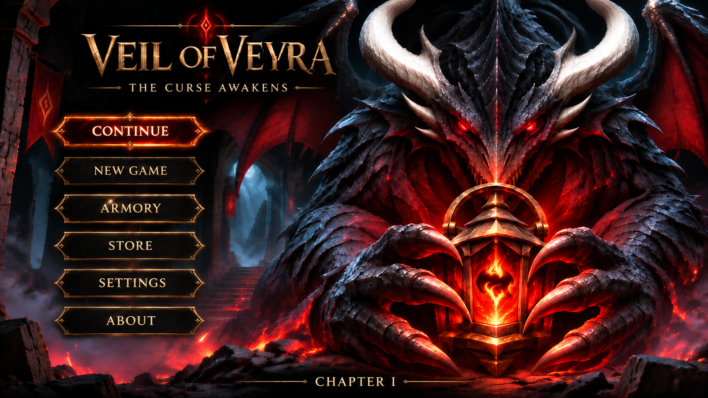
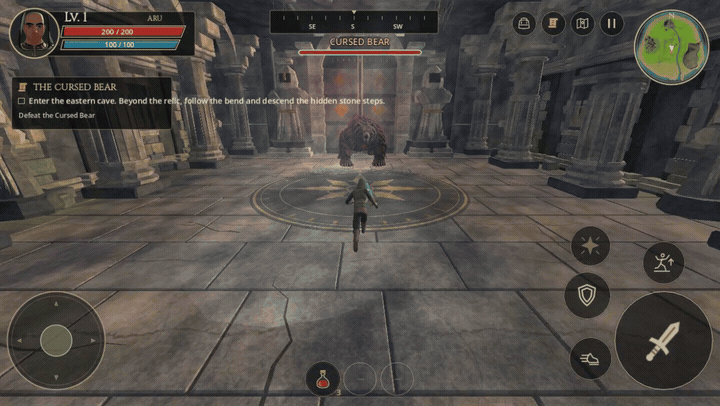
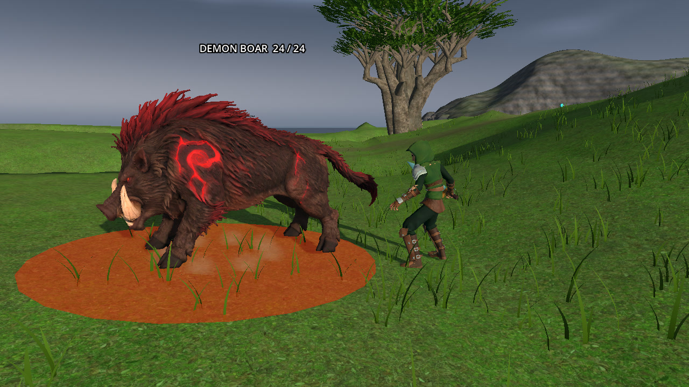
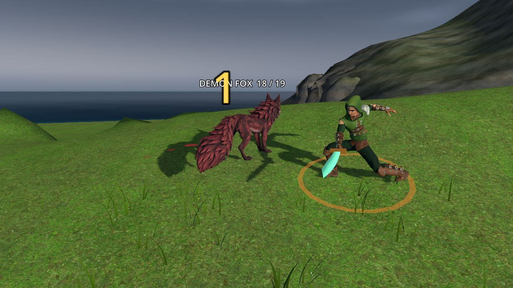
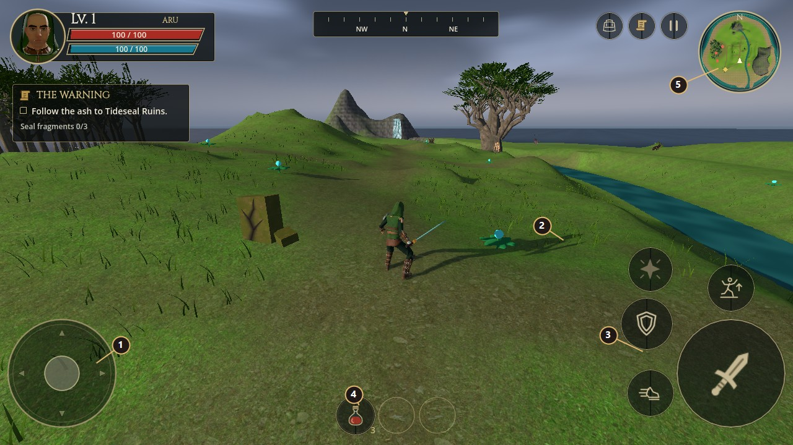
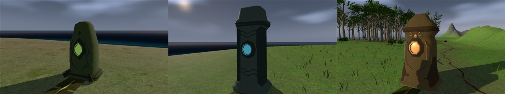
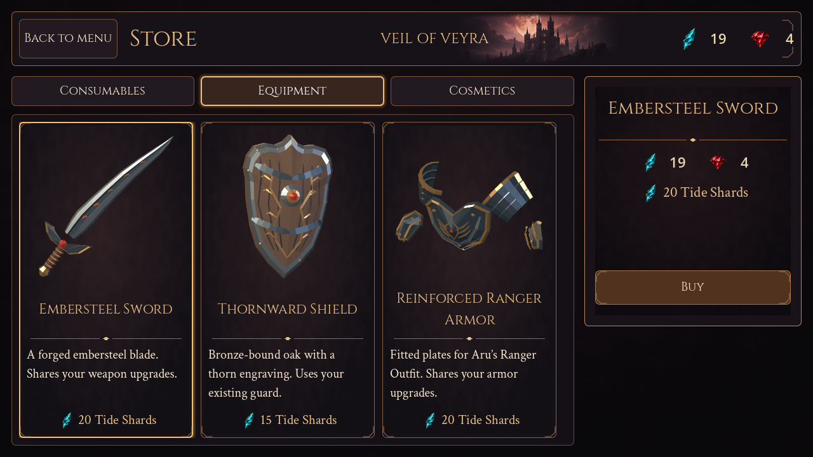

<p align="center">
  
</p>

# Veil of Veyra

**The Curse Awakens · Chapter I**

A single-player dark fantasy action RPG for Android, created and developed by **Logachandran Hirukshanan**.


A warning bell falls silent on the shore. Playing as Aru, you follow a stain of ash from the beach camp to Tideseal Ruins, where an ancient seal lies broken. Three cursed guardians carry its fragments. The first mystery is how to rekindle the Northern Lantern. The next is what left claw marks in the grove beyond it.

[Combat footage](#in-combat) · [Touch controls](#playing-on-android) · [Island and progression](#across-the-island) · [Run the project](#run-the-project)

## In combat

<p align="center"></p>

**Cursed Bear · Eastern cave.** An orange lane marks the Bear's charge as it lines up Aru. A sideways dodge lets the Bear rush past. Later in the fight, it enters Rage at 40% health and recovers faster between attacks.

<table>
<tr>
<td width="50%"><a href="docs/screenshots/boar-stomp.jpg"></a><br><b>Demon Boar · Ground stomp</b><br>Aru is just outside the impact circle as the hooves hit. Staying close invites a tusk sweep or stomp. At a distance, watch for the charge.</td>
<td width="50%"><a href="docs/screenshots/fox-counter.jpg"></a><br><b>Demon Fox · Leap and counter</b><br>The landing ring gives away the Fox’s destination. Here Aru’s blade catches it mid-approach. During Phantom Veil, follow the shimmer and crimson eyes to read its next flank.</td>
</tr>
</table>

Both stills were captured in the playable Chapter I island with a close review camera. Tap the sword for a light strike, hold for a heavy blow, or keep enough stamina to dodge the next attack. A full Spirit meter unlocks Spirit Burst.

## Playing on Android

<a href="docs/screenshots/chapter-one-exploration.png"></a>

| On the screen | How to use it |
| --- | --- |
| **1 · Movement stick** | Drag to walk. Hold beyond the upper rim to sprint. Drag farther up and hold for auto-sprint, then touch the stick again to stop. |
| **2 · Open camera space** | Drag across open space to look around while moving. Pinch to adjust the camera distance. |
| **3 · Combat buttons** | Tap the sword to attack or hold it for **0.4 seconds** for a heavy strike. Hold the shield to guard. Dodge, Jump and Spirit Burst have separate buttons. |
| **4 · Quick items and interactions** | Tap the potion at the bottom to heal. Near a plant, seal socket or investigation clue, use the contextual Pick / Interact prompt. |
| **5 · Navigation** | Use the top-right circular minimap and compass to keep your heading. Open the journal scroll to choose a tracked objective, or pause to save and return to camp. |

<details>
<summary><b>Keyboard and mouse bindings for development</b></summary>

| Action | Binding |
| --- | --- |
| Move / sprint | WASD or arrow keys / Shift |
| Orbit camera | Hold the right mouse button and drag |
| Light / heavy attack | J / H |
| Guard / dodge / jump | F / K / Space |
| Spirit Burst / interact | L / E |
| Journal / pause | Q / Esc |
| Heal | Click the potion slot |

</details>

## Across the island

**The forest shrine.** The journal lets you track one guardian at a time and approach the three hunts in any order. At the Forgotten Tidewarden Shrine, each recovered fragment fits its own socket. Restoring all three lights the central beacon. Heavy prints and damaged bark carry the investigation onward to Ancient Grove and the eastern cave.

[](docs/screenshots/tidewarden-shrine.png)

*The three lit seals, pictured in the shrine visual review. Select the image for the complete shrine in Chapter I.*

**Equipment and rewards.** The Store spends Tide Shards on potions and standard equipment. The Armory lets you rotate Aru, preview gear, equip it and compare the next upgrade against your current stats. The Embersteel Sword shares weapon upgrades with the starter blade. Equipment ownership, upgrades, currencies and quest progress carry through saves.

<table>
<tr>
<td width="50%"><a href="docs/screenshots/equipment-store.png"></a><br><b>Store</b> · Inspect an item and its Tide Shard price.</td>
<td width="50%"><a href="docs/screenshots/chapter-one-armory.png"></a><br><b>Armory</b> · Inspect the fit on Aru before committing to a loadout.</td>
</tr>
</table>

**Veil Gems** are first-clear rewards. Each fragment guardian grants one, the Cursed Bear grants two, and finishing Chapter I grants one more. The chapter total is six. Crimson equipment appearances and cosmetic spending are planned.

## Run the project

| | Project details |
| --- | --- |
| **Game** | Playable Chapter I, version **0.12.7**. Android landscape, single player. |
| **Stack** | Godot **4.7.2** standard edition, GDScript, GL Compatibility renderer, Git LFS for large assets. |
| **Development machine** | A graphics driver compatible with Godot’s GL Compatibility renderer, Git and Git LFS. |
| **Android export** | Matching Godot export templates, Java SDK and Android SDK. The debug preset targets ARM64. |

```sh
git lfs install
git clone https://github.com/Hirukshanan/veil-of-veyra.git
cd veil-of-veyra
git lfs pull
git lfs fsck --objects HEAD
```

Follow the [licensed character asset setup](assets/characters/literock/README.md) for the intended enemy visuals. Open `project.godot`, allow imports to finish, then press **F5**. The normal entry point is [Chapter I](scenes/chapter_one.tscn).

<details>
<summary><b>Repository guide and validation</b></summary>

| Directory | Contents |
| --- | --- |
| `scenes/` and `scripts/` | Chapter entry point, island, combat, quests and menus |
| `assets/` and `art_source/` | Runtime assets, editable art sources and attribution |
| `tests/` and `tools/` | Godot regression scripts, preparation tools and build helpers |
| `docs/` | Design records, milestone evidence, screenshots and credits |

[Android setup and debug export](ANDROID_SETUP.md) · [Regression tests and isolated saves](VALIDATION.md) · [Documentation index](docs/README.md)

</details>

## Development status

Chapter I is playable from the opening warning through the shrine, Grove investigation, cave encounter and Lantern Awakening finale. Physical Android acceptance is still pending for touch, audio, cinematics, memory and sustained FPS and temperature. Samsung Galaxy A37 is a validation target. Minimum supported device specifications have yet to be established. See [release status](RELEASE_STATUS.md).

## Credits and licensing

**Logachandran Hirukshanan** — creation, development, game design, story and worldbuilding, creative direction, original soundtrack and music direction. Custom soundtracks were produced under his direction using AI-assisted music generation.

Aru’s base character, outfit and animation library are by Quaternius. Literock Studios supplied the Dire Wolf Lite model, Pigcraft created the original dragon model, and Poly Haven contributors supplied environment assets. License terms vary by asset. See [project credits, source records and license notices](docs/PROJECT_CREDITS.md).
