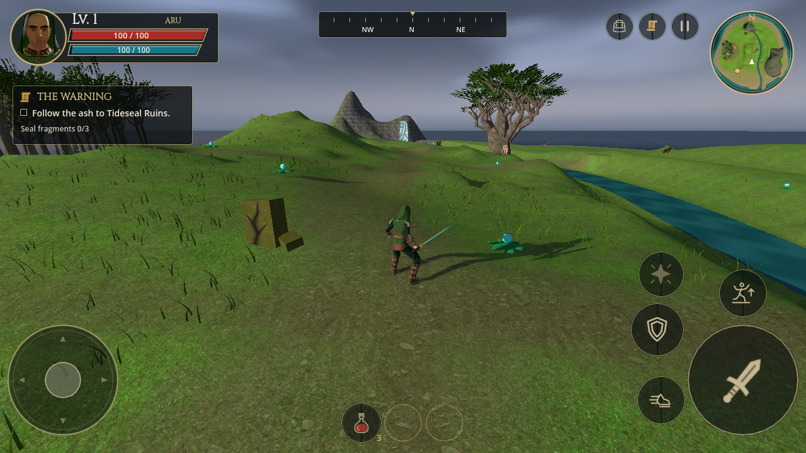
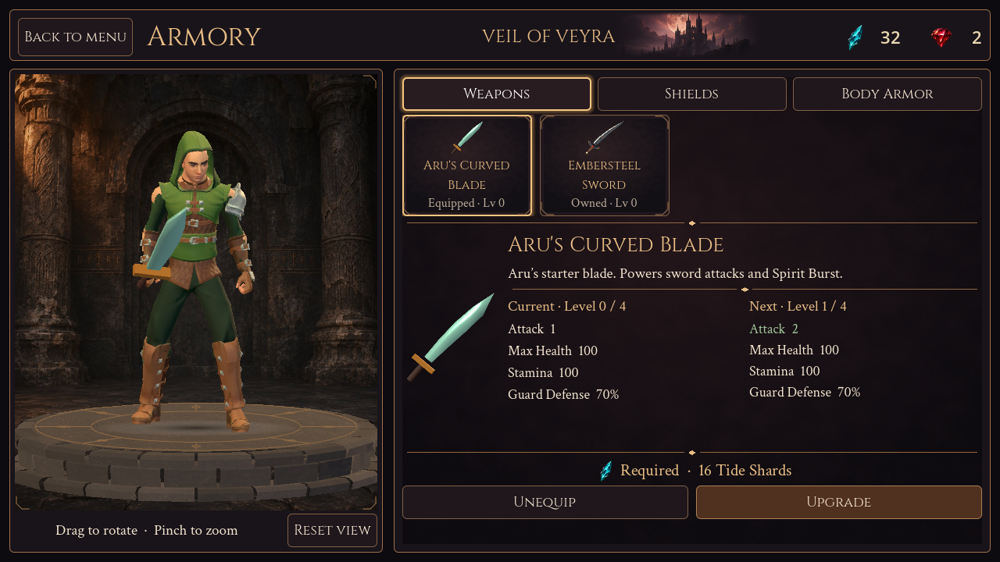

# Veil of Veyra

**The Curse Awakens — Chapter I**

Created and developed by **Logachandran Hirukshanan**.

Veil of Veyra is a single-player dark fantasy action RPG built for Android landscape play. As Aru, explore a curse-stricken island, recover the fragments of an ancient seal, and follow the Lantern’s trail beneath the forest. Desktop play is available for development and validation.



## Playable Chapter I

- **Explore a connected island.** Cross the coast, forest, foothills and riverbanks, discover the Tidewarden Shrine and Ancient Grove, and use the Quest Journal and circular minimap to track objectives.
- **Fight with readable timing.** Chain sword attacks, guard, dodge and use Spirit Burst. Wolves populate the island, and the Dire Warg, Demon Fox and Demon Boar guard the seal fragments. The Cursed Bear encounter takes place in the eastern cave.
- **Restore the seal.** Take the guardian fragments to the forest shrine and investigate the signs of the curse. Chapter I closes with Lantern Awakening and a cinematic.
- **Build Aru’s loadout.** Buy potions and standard equipment in the Store with Tide Shards. Preview, equip and upgrade owned gear in the Armory. Equipment ownership, upgrade levels and currency balances persist in the campaign save.
- **Earn Veil Gems.** The rare currency is awarded once per eligible guardian, boss and Chapter I milestone. It is reserved for future cosmetic appearances. The current Store sells consumables and standard equipment.



## Run locally

Install standard **Godot 4.7.2**, Git and Git LFS. The project uses GDScript and the GL Compatibility renderer.

```sh
git lfs install
git clone https://github.com/Hirukshanan/veil-of-veyra.git
cd veil-of-veyra
git lfs pull
git lfs fsck --objects HEAD
```

1. Install the licensed [Dire Wolf Lite model](assets/characters/literock/README.md) locally for the intended wolf visuals.
2. Open `project.godot` in Godot and let imports finish.
3. Press **F5** to run the project. The normal entry point is `scenes/chapter_one.tscn`.

## Controls

| Action | Android landscape | Desktop development |
| --- | --- | --- |
| Move and sprint | Virtual joystick. Hold past its upper edge to sprint | WASD or arrow keys, Shift to sprint |
| Camera | Drag to orbit, pinch to zoom | Hold right mouse button and drag |
| Sword and heavy attack | Tap or hold the sword button | J / H |
| Guard, dodge and jump | Guard, Dodge and Jump buttons | F / K / Space |
| Spirit Burst | Spirit Burst button | L |
| Interact and heal | Interact and potion buttons | E to interact, click the potion button |
| Quest Journal and pause | Journal and Pause buttons | Q / Esc |

The circular minimap shows heading and nearby objectives.

## Build and validate

- [Android setup and debug export](ANDROID_SETUP.md) covers SDK prerequisites, signing, package verification and device checks.
- [Validation](VALIDATION.md) lists active Chapter I regressions and shows how to isolate test saves.
- [Release status](RELEASE_STATUS.md) summarizes the playable build and remaining work. Physical device coverage and sustained thermal performance still need validation. Crimson equipment and cosmetic purchases are planned.

## Repository layout

| Path | Contents |
| --- | --- |
| `scenes/`, `scripts/` | Playable scenes, gameplay, menus and isolated previews |
| `assets/` | Runtime models, textures, UI, audio and attribution |
| `art_source/` | Editable art sources and asset preparation history |
| `tests/`, `tools/` | Godot regression scripts and build tools |
| `docs/` | [Documentation index](docs/README.md), project credits and milestone evidence |

See [Game Design](GAME_DESIGN.md) for the current design and [Project Credits](docs/PROJECT_CREDITS.md) for creator, soundtrack and third-party attributions. Individual asset licenses and source notices are stored alongside the assets.
