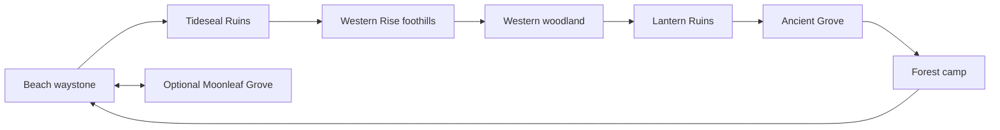

# Chapter I geography and route layout

Phase 1, authorized by the owner after the Phase 0 audit. Work continues on `main`, from clean baseline `f7203d1`. All coordinates below use Godot metres, with north along negative Z.

## Connected places

The diagram describes a navigation loop, not a new quest order or progression gate. Existing enemies, the three seal fragments, lantern prerequisites, optional quests and Dragon boss retain their current behavior until their later approved phases.

| Place | Position / extent | Treatment |
| --- | --- | --- |
| Beach arrival / waystone 1 | `(0, 0, 27)` | Existing spawn, shore access and branching paths retained. |
| Tideseal Ruins | `(-44, 0, 54)` | Existing ruin, three pickup coordinates and south-west trail retained. New northbound woodland trail starts here. |
| Western Rise | Existing hill at `(-64, 7, 18)` | Trail follows its eastern foothills, rather than flattening/climbing through the terrain. Waymark points to the optional open hillside. |
| Western woodland | Existing ellipse centered `(-39, -7)`, radii `(20, 26)` in X/Z | New path passes through the existing trees; exclusion mask leaves a corridor while keeping solid remaining trunks and batched canopies. |
| Central junction | `(0, 0, -13)` | Small realignment avoids an existing central trunk. The next bend uses `(3, 0, -16)` and `(3, 0, -20)` to pass around the southern ruin pillar. Neither obstacle was made non-solid. |
| Lantern Ruins / waystone 3 | Camp `(0, 0, -25)`, waystone `(0, 0, -20)` | Existing lantern, pillars and combat state retained. North-east exit passes through the existing gap between pillars. |
| Ancient Grove | `(9, 0, -45)`, usable radius `9 m` | Separate nearly level clearing at the western edge of the north-east woodland; tree exclusion radius `10.5 m`. The shared ground/grass mask makes the floor readable. No Bear, combat gate or reward trigger yet. |
| Eastern woodland return | Through `(18,-39)`, `(29,-31)`, `(30,-19)` in X/Z, ending at forest camp `(16,0,-4)` | Routes around the existing ring of rocks; uses the same dirt mask/map route data. |
| Optional Moonleaf Grove | `(44, 0, 28)` | Original flowers, entrance, reward, save IDs and southern branch retained; not repurposed as the boss arena. |

The five original route indices remain 0–4. Routes 1–4 keep their original control points; route 0 has the small trunk/pillar detour above. Three new routes append as indices 5–7: Tideseal → western woodland → central junction, Lantern Ruins → Ancient Grove, Ancient Grove → eastern woodland → forest camp. Every consumer (ground, grass, forest and map) uses `island_terrain.gd::trails()` and its cached mask.

## Reserved Dragon viewpoint

`scripts/chapter_one_region.gd` owns the shared constants and runtime `Marker3D` nodes under `IslandExploration/ChapterOneRegion`:

| Marker | Transform / purpose |
| --- | --- |
| `AncientGrove` | `(9, 0, -45)`, `clear_radius=9`; later arena planning anchor. |
| `DragonPerch` | `(39, 10, -55)`, on the existing 10 m northern hill; faces the reserved camera horizontally. |
| `DragonCamera` | `(9, 2.8, -45)`, aimed at `(39,12,-55)`, suggested FOV 42 degrees stored as metadata. |
| `DragonLookAt` | `(39, 12, -55)`; framing target. |

A 5 m horizontal tree-placement exclusion along the camera-to-perch segment keeps a clear viewing corridor. Center and offset rays are checked against terrain/camera blockers; native preview uses the existing Dragon model only in an ignored validation script. These markers do not create a camera, spawn a Dragon, start a cutscene or write story flags. Final shot composition, reveal/skip/resume and recognizable eyes/horns in the story remain Phase 5 work.

## Wayfinding and costs

Four small project-native stone markers sit beside paths at `(-37,0,27)`, `(-43,0,7)`, `(-2,0,-40)` and `(31,0,-16)`. Their brief compass directions avoid mandatory NPC conversations. Shared stone geometry/material is culled at 35 m; labels at 18 m. Stones block both player and camera. The grove name label culls at 22 m.

The map draws the same trails, a gold-ring Ancient Grove marker, a Western Rise caption and a distinct Moonleaf caption. Smaller map panels use 14 px captions; larger panels retain 16 px. The existing map legend explains the loop without exposing development anchors or promising unavailable boss/download features.

Tall forest count changes from 54 to 38 as trail/grove/vista clearances change deterministic placement. Both woodland patches must retain at least 12 tall trees; the combined budget is bounded at 32–65. This deliberately replaces the previous generic minimum-40 assumption with per-woodland coverage checks. Tall-tree height, mesh budgets, batching/culling, individual trunk collision and clear beaches remain tested. No colliders were removed from retained trees or rocks to improve performance.

Terrain geometry/heights/radii, sea shader/material, quest/pickup coordinates, enemy spawn IDs, save version 4 and all existing rewards are unchanged. The grove reuses the one-time cached mask rather than adding an overlay or per-frame route processing. No third-party assets were acquired.

## Verification and outstanding acceptance

`tests/chapter_route_check.gd` sweeps a slightly oversized player capsule along the new trails and adjusted spine, samples the clear level floor, checks solid waymarks and Dragon sightlines, then drives the actual player controller around the full loop and optional Moonleaf branch in both directions where needed. It visits 711 baked waypoints, returns to the shore, and verifies a partial seal save/reopen at the new grove without progressing the story. Enemies are frozen to isolate geography. Simulation steps are approximately 30 Hz; wall time is accelerated 4x. This is not a combat or touch-device playtest.

Existing terrain, collision, camera, quest, map, travel and save checks are rerun for the final phase report. Controlled native screenshots, desktop render samples and route footage are local under `.validation/ch1_phase1_2026-11-13/`. Final results, build limitations and device acceptance are recorded in `CH1_PHASE1_REPORT.md`.

Physical-phone frame time, sustained thermals/battery and actual two-thumb traversal remain pending until a handset is available. Native desktop force-draw/minimized timings cannot certify a mobile performance target.
