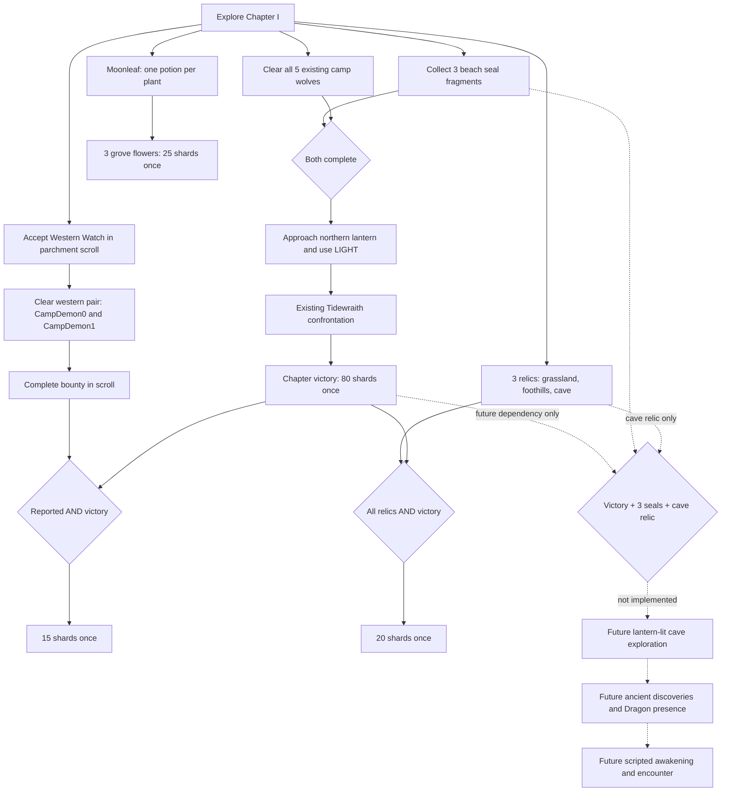

# Chapter I quest dependencies

Solid links below are existing playable dependencies. Dashed links describe the future deep-cave story only. They are not triggers or new restrictions. The existing cave relic stays accessible before victory. Earlier objective completion counts even before bounty acceptance.

The future prerequisite view reads `completed`, `seal_fragments` and cave relic ID 1. It stores nothing and fires nothing. The reserved hall, future lantern item/lighting, ancient discovery events, awakening and final encounter remain outside Phase 6.1. The current northern lantern remains a world interaction, not a newly granted inventory lantern.
